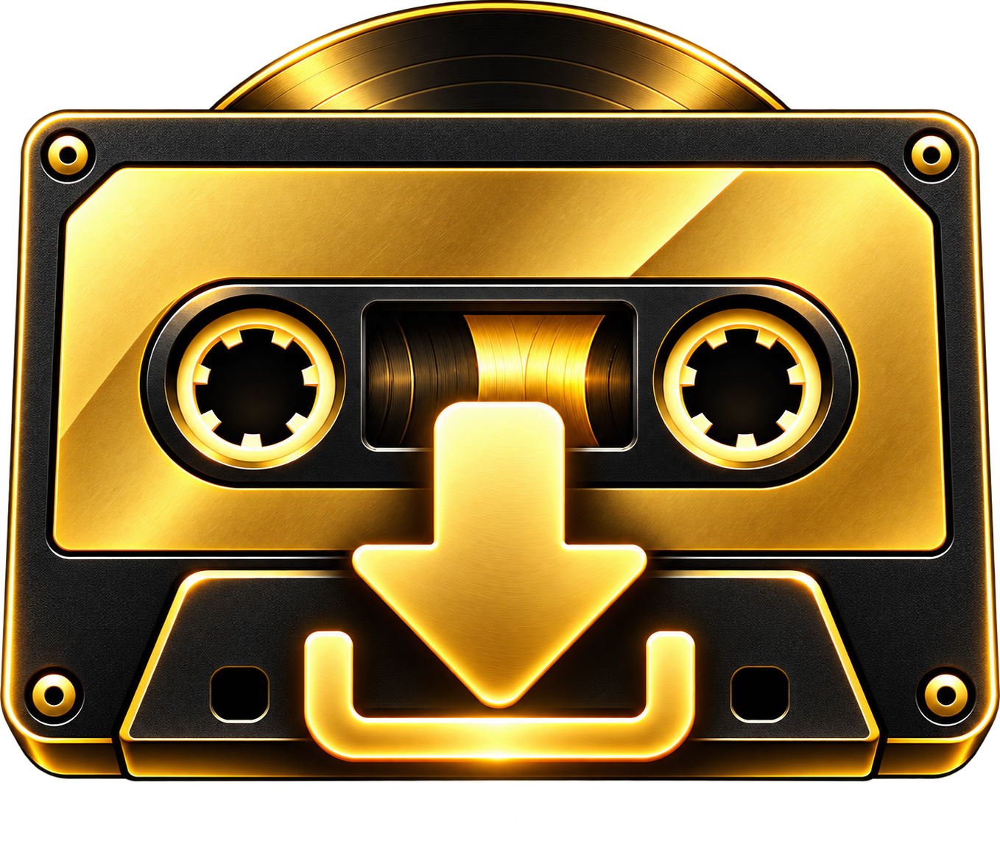

# Mixtape Downloader

**Audiomack and LiveMixtapes releases for Windows and Android.**

## Download

Get the Windows installer and Android APK together from the [latest release](https://github.com/ZoneJ561/Mixtape-Downloader/releases/latest). Both files are attached to the same release. The source code is maintained in private repositories; this page contains the official installable files.

## Features

### Music Downloads

- Paste an Audiomack or LiveMixtapes link to see the release cover and complete tracklist.
- Choose individual tracks or download the full release.
- Save M4A or MP3 files with track numbers and music tags.
- Keep each release in its own folder with the release name.
- On Android, continue downloading after leaving the app and follow progress in the notification shade.

### Interface And Updates

- Use the Gold, Light, or Dark theme on Windows and Android.
- Choose where Android saves your music on first launch.
- Check for updates automatically when either app opens.
- Download updates from GitHub, verify their SHA-256 digest, and review the changes before installing.

## Supported Sites

| Site | Supported content |
| --- | --- |
| Audiomack | Public songs and releases |
| LiveMixtapes | Mixtapes with guest downloads or public playback streams |

## Getting Started

1. Download the installer or APK from the [Releases page](https://github.com/ZoneJ561/Mixtape-Downloader/releases).
2. Open the app and choose a music folder.
3. Paste a supported release link, select tracks or the full release, and choose **Download**.

## Platform Support

| Platform | Status |
| --- | --- |
| Windows | Available |
| Android phones (32-bit and 64-bit ARM) | Available |

## Project Updates And Support

- Follow the project creator on Instagram: [@God1yNigga](https://instagram.com/god1ynigga)
- Support development through Venmo: [venmo.com/godlynigga](https://venmo.com/u/godlynigga)
